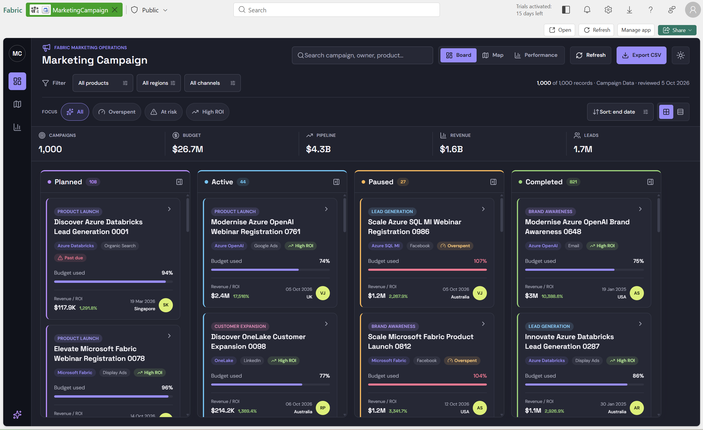
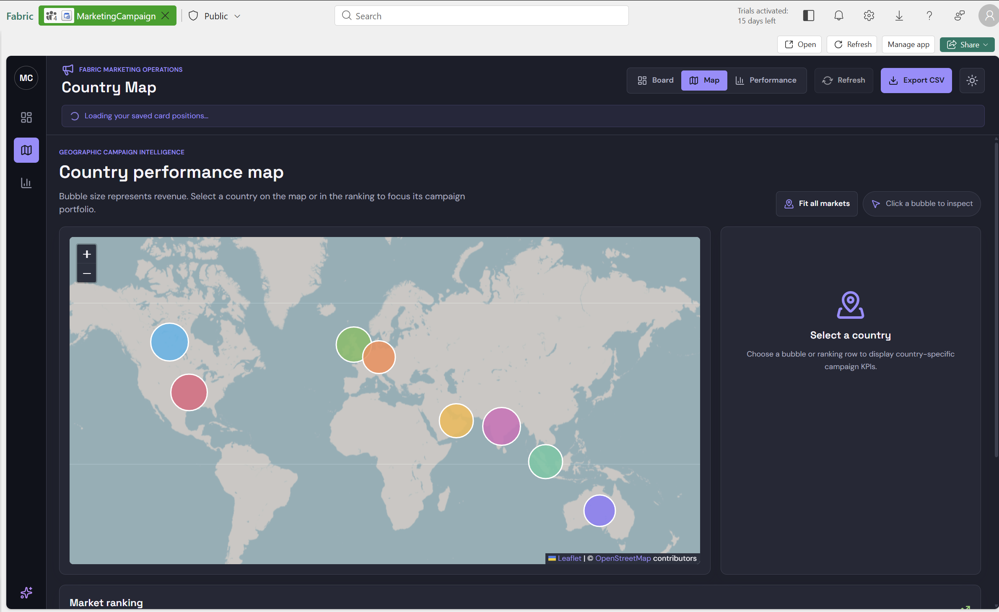
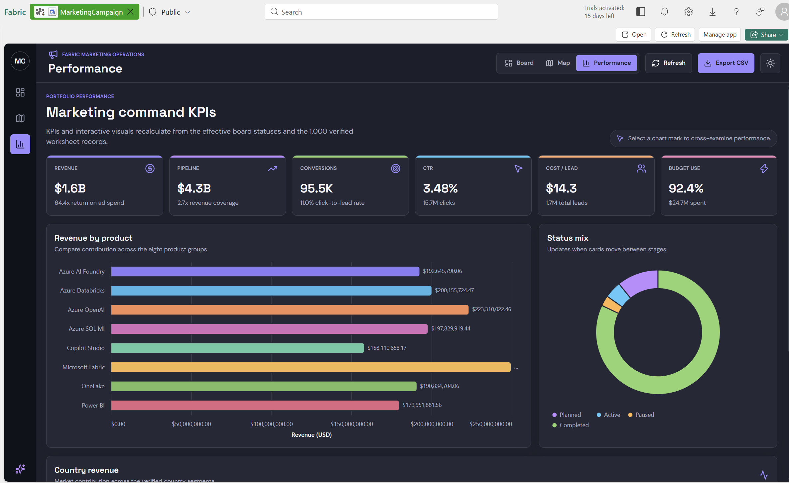

# Marketing Campaign — Microsoft Fabric App

A production-ready Rayfin application for managing and analyzing marketing
campaigns in Microsoft Fabric. The solution combines a status board, persistent
campaign workflow, geographic analysis, and executive performance KPIs in one
authenticated Fabric experience.

> React + TypeScript · Rayfin · Microsoft Fabric SSO · Per-user status
> persistence · OpenStreetMap · Fabric Vega visuals



## Table of contents

- [Overview](#overview)
- [Key capabilities](#key-capabilities)
- [Architecture](#architecture)
- [Data model](#data-model)
- [Prerequisites](#prerequisites)
- [Step-by-step setup](#step-by-step-setup)
- [Local development](#local-development)
- [Deploy to Microsoft Fabric](#deploy-to-microsoft-fabric)
- [Use your own campaign data](#use-your-own-campaign-data)
- [Repository structure](#repository-structure)
- [Validation](#validation)
- [Troubleshooting](#troubleshooting)
- [Publishing without credentials](#publishing-without-credentials)
- [Security notes](#security-notes)

## Overview

The application loads a typed campaign-data snapshot into the frontend and
persists only user-driven status changes through Rayfin data services. This
keeps the source dataset portable while allowing each authenticated user to
organize campaigns independently.

| Component | Purpose |
| --- | --- |
| Rayfin Fabric App | Hosts the protected application in Microsoft Fabric |
| Fabric SSO | Authenticates the current user |
| React frontend | Board, details, filters, country map, and KPI pages |
| Campaign snapshot | Bundled sample records from the `Campaign Data` worksheet |
| Rayfin data service | Stores per-user campaign status overrides |
| OpenStreetMap | Provides the interactive country basemap |
| Fabric Vega visuals | Renders product, status, and country performance charts |

No Fabric workspace ID, item ID, tenant ID, capacity ID, publishable key,
access token, client secret, or deployed application URL is committed.

## Key capabilities

### Campaign board

- Planned, Active, Paused, and Completed workflow columns
- Drag-and-drop card movement between every status
- Accessible status controls in the campaign details panel
- Search by campaign, owner, or product
- Product, region, channel, health, and risk filters
- Revenue, pipeline, leads, campaign count, and budget KPIs
- Budget-use, end-date, revenue, and ROI sorting
- Comfortable and compact card layouts

### Persistent user workflow

- Only status overrides are persisted
- Optimistic UI updates with rollback on failure
- Authenticated entity permissions
- Row-level security based on the signed-in user
- Workbook/sample data remains unchanged

### Country analytics

- Recognizable OpenStreetMap basemap
- Revenue-sized country markers
- Country ranking and market focus controls
- Campaign, budget, revenue, conversion, and efficiency KPIs



### Performance analytics

- Revenue
- Pipeline
- Conversions
- Click-through rate
- Cost per lead
- Budget utilization
- Revenue by product
- Campaign status mix
- Revenue by country



## Architecture

```text
┌──────────────────────────── Microsoft Fabric ─────────────────────────────┐
│                                                                          │
│  ┌──────────────────────── Rayfin Fabric App ──────────────────────────┐ │
│  │                                                                    │ │
│  │  Fabric SSO ──▶ React application                                 │ │
│  │                     │                                              │ │
│  │                     ├── Campaign board and details                 │ │
│  │                     ├── OpenStreetMap country analytics           │ │
│  │                     ├── Fabric Vega performance visuals           │ │
│  │                     └── CSV export                                │ │
│  │                                                                    │ │
│  │  Bundled campaign snapshot ──▶ Effective campaign state           │ │
│  │                                      ▲                             │ │
│  │                                      │                             │ │
│  │  Rayfin data service ──▶ Per-user status overrides                │ │
│  └────────────────────────────────────────────────────────────────────┘ │
│                                                                          │
└──────────────────────────────────────────────────────────────────────────┘
```

### Runtime flow

1. Fabric or standalone Rayfin authentication establishes the user session.
2. The frontend loads the bundled campaign snapshot.
3. Rayfin retrieves status overrides owned by the current user.
4. Overrides are merged over the source status by campaign ID.
5. Board, map, and KPI pages recalculate from the effective campaign state.
6. A card move is applied optimistically and persisted to Rayfin.
7. Failed writes are rolled back and surfaced to the user.

## Data model

`CampaignStatusOverride` stores only the mutable workflow state:

| Field | Purpose |
| --- | --- |
| `id` | Override record identifier |
| `campaignId` | Stable campaign key |
| `status` | Planned, Active, Paused, or Completed |
| `updatedAt` | Last update timestamp |
| `owner_id` | Authenticated user subject used for row-level security |

Campaign facts and metrics remain in
`packages/frontend/src/data/campaigns.ts`.

## Prerequisites

| Requirement | Details |
| --- | --- |
| Node.js | Supported Node.js 20, 22, or 24 release |
| npm | Installed with Node.js |
| Git | Required to clone and contribute |
| Microsoft Fabric | Workspace assigned to active Fabric capacity |
| Workspace access | Contributor, Member, or Admin access as required by policy |
| Rayfin access | Account permitted to create and deploy Fabric Apps |
| Browser | Current Microsoft Edge or Google Chrome |
| Network | Access to Microsoft sign-in, Fabric, npm, and OpenStreetMap tiles |

The original Excel workbook is intentionally excluded from source control.
The repository includes a typed sample snapshot, so a workbook is not required
to run the application.

## Step-by-step setup

### 1. Clone the repository

```powershell
git clone https://github.com/nikunj11itdhm/Fabric-App-Rayfin-MarketingCampaign.git
Set-Location Fabric-App-Rayfin-MarketingCampaign
```

### 2. Install dependencies

```powershell
npm install
```

Do not create or commit local environment files manually. Rayfin generates
runtime configuration during authentication, development, and deployment.

### 3. Sign in to Rayfin

```powershell
npx rayfin login
```

Complete Microsoft sign-in with an account that can access the target Fabric
workspace.

### 4. Run locally

```powershell
npm run dev
```

Open the local URL shown by Vite, normally:

```text
http://localhost:5173
```

Rayfin local development uses the authenticated CLI session. If sign-in has
expired, run `npx rayfin login` again.

### 5. Validate the project

```powershell
npm run typecheck
npm run build
npm run lint
npm test
npm run validate:visual:preview
```

The visual preview validator may report incomplete static schema coverage
because the Vega specifications are TypeScript runtime objects. The build,
tests, and browser preview remain the required validation gates.

## Local development

| Command | Purpose |
| --- | --- |
| `npm run dev` | Start Rayfin services and the Vite frontend |
| `npm run dev:frontend` | Start only the frontend |
| `npm run typecheck` | Type-check all workspace packages |
| `npm run build` | Build the data and frontend packages |
| `npm run build:fabric` | Create the Fabric hosting build |
| `npm run lint` | Run ESLint |
| `npm test` | Run the Vitest suite |
| `npm run preview` | Preview the production frontend build |
| `npm run validate:visual:preview` | Validate detectable visual definitions |

## Deploy to Microsoft Fabric

### 1. Confirm capacity and permissions

Before deployment:

1. Open the target Fabric workspace.
2. Confirm the workspace is assigned to an active capacity.
3. Confirm your account can create Fabric items.
4. Confirm tenant policy permits Fabric Apps and Rayfin authentication.

### 2. Preview the deployment

```powershell
npx rayfin up -n --json `
  --workspace-id <fabric-workspace-id> `
  --item-name MarketingCampaign
```

Review the plan and confirm there are no warnings or blockers.

### 3. Deploy

```powershell
npx rayfin up --json `
  --workspace-id <fabric-workspace-id> `
  --item-name MarketingCampaign
```

Do not use `--force` unless Rayfin explicitly reports that it is required and
you understand the replacement impact.

### 4. Add the deployed redirect URI

After the first deployment, Rayfin returns a URL similar to:

```text
https://<generated-name>.<region>.webapp.fabricapps.net
```

Add that exact origin to `services.auth.allowedRedirectUris` in
`rayfin/rayfin.yml`, then deploy once more:

```yaml
allowedRedirectUris:
  - http://localhost:5173
  - http://127.0.0.1:5173
  - https://<generated-name>.<region>.webapp.fabricapps.net
```

```powershell
npx rayfin up `
  --workspace-id <fabric-workspace-id> `
  --item-name MarketingCampaign
```

Keep the generated URL and all Fabric identifiers in local deployment state,
not in Git.

### 5. Verify deployment health

```powershell
npx rayfin up status --json
```

Confirm:

- `deployed` is `true`
- authentication is enabled
- data service is enabled
- the management endpoint is reachable
- the Fabric capacity is running

Anonymous requests to the protected app should receive an authentication
challenge. Campaign content must not render before sign-in succeeds.

## Use your own campaign data

The included sample data follows the `CampaignRecord` interface in:

```text
packages/frontend/src/data/campaigns.ts
```

To replace it:

1. Prepare data containing the fields defined by `CampaignRecord`.
2. Preserve a unique `campaignId` for every row.
3. Normalize status values to `Planned`, `Active`, `Paused`, or `Completed`.
4. Replace the exported `campaigns` array.
5. Update `campaignDataSource` with a non-sensitive workbook and worksheet
   description.
6. Run type-check, build, lint, and tests.
7. Test card movement before deploying.

Do not commit a confidential workbook, customer data, personal data, or
credentials. For private datasets, generate the TypeScript snapshot locally or
replace the snapshot architecture with an approved Fabric data source.

## Repository structure

```text
Fabric-App-Rayfin-MarketingCampaign/
├── .agents/skills/rayfin/             # Version-aligned Rayfin guidance
├── demo/
│   ├── marketing-campaign-board.png
│   ├── marketing-campaign-map.png
│   ├── marketing-campaign-performance.png
│   └── README.md
├── packages/
│   ├── data/
│   │   └── src/CampaignStatusOverride.ts
│   ├── frontend/
│   │   └── src/
│   │       ├── data/campaigns.ts
│   │       ├── hooks/use-campaign-status-overrides.ts
│   │       ├── pages/CampaignMapPage.tsx
│   │       ├── pages/PerformancePage.tsx
│   │       ├── visuals/campaign-specs.ts
│   │       └── App.tsx
│   └── shared/
├── rayfin/
│   └── rayfin.yml
├── scripts/
├── .gitignore
├── package.json
└── README.md
```

## Validation

The project is expected to pass:

```powershell
npm run typecheck
npm run build
npm run lint
npm test
```

The tests cover authentication boundaries, theme behavior, campaign search,
campaign details, status movement intent, and application page navigation.

## Troubleshooting

### The hosted app returns HTTP 500

Confirm the Fabric capacity is running. A paused capacity can make the hosting
endpoint unavailable even when the Rayfin deployment configuration is healthy.

### The hosted app returns `Authentication required`

This is expected for an anonymous request because static asset access is
protected. Open the application in a browser and complete Microsoft sign-in.

### Rayfin cannot resolve a workspace

Run `npx rayfin login`, confirm the correct account is active, and verify that
the account has access to the target workspace.

### Card moves do not persist

Check:

1. Rayfin data service is enabled.
2. The deployed database is healthy.
3. The current user is authenticated.
4. The browser console contains no rejected data-service request.
5. Row-level security still compares `owner_id` to the authenticated subject.

### The country map is blank

Confirm the browser can reach OpenStreetMap tile servers and that corporate
network policy is not blocking tile requests.

### Build reports a large JavaScript chunk

The app includes Fabric visual libraries, map rendering, and the bundled sample
dataset. The Vite chunk warning is non-blocking. Route-level code splitting can
be added if startup size becomes a deployment requirement.

## Publishing without credentials

Generated Rayfin state is ignored:

```text
.env.local
packages/frontend/.env.local
rayfin/.env
rayfin/.env.secrets
rayfin/.deployments.json
packages/frontend/dist/
```

Before every commit:

```powershell
git status --short
git check-ignore -v `
  packages/frontend/.env.local `
  rayfin/.env `
  rayfin/.deployments.json `
  marketing_campaign_data.xlsx

git grep -n -I -E `
  "(client[_-]?secret|api[_-]?key|refresh[_-]?token|connection[_-]?string|AccountKey|SharedAccessSignature)"
```

Use Git Credential Manager or GitHub CLI browser authentication. Never paste a
personal access token into source files, `.env.example`, terminal scripts, or
Git history.

## Security notes

- Application content is protected until authentication succeeds.
- Password authentication is disabled.
- Status overrides are scoped to the authenticated user.
- The original workbook is excluded from Git.
- Deployment IDs and generated publishable configuration are excluded.
- No client secret, access token, refresh token, storage key, or connection
  string is required by this repository.
- If a secret was ever committed, revoke or rotate it before rewriting history.

## Contributing

1. Create a branch from `main`.
2. Keep deployment state and datasets out of Git.
3. Make focused changes.
4. Run type-check, build, lint, and tests.
5. Open a pull request describing behavior and validation.

## License

This project is licensed under the MIT License. See [LICENSE](LICENSE).
